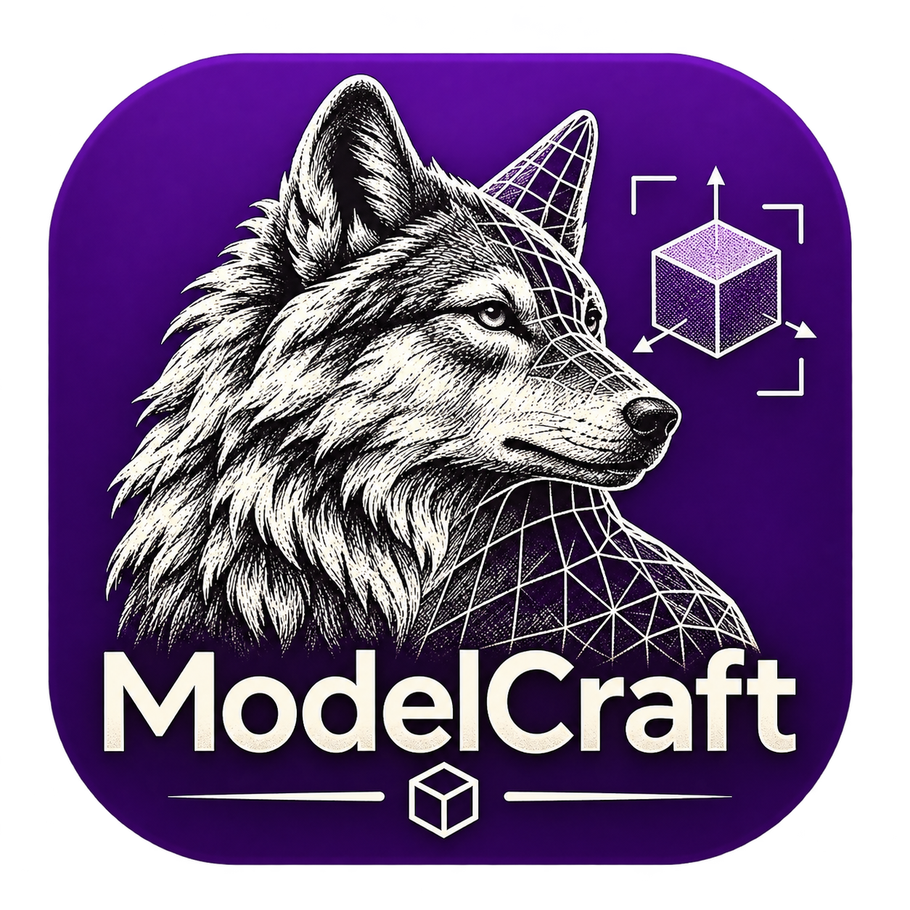
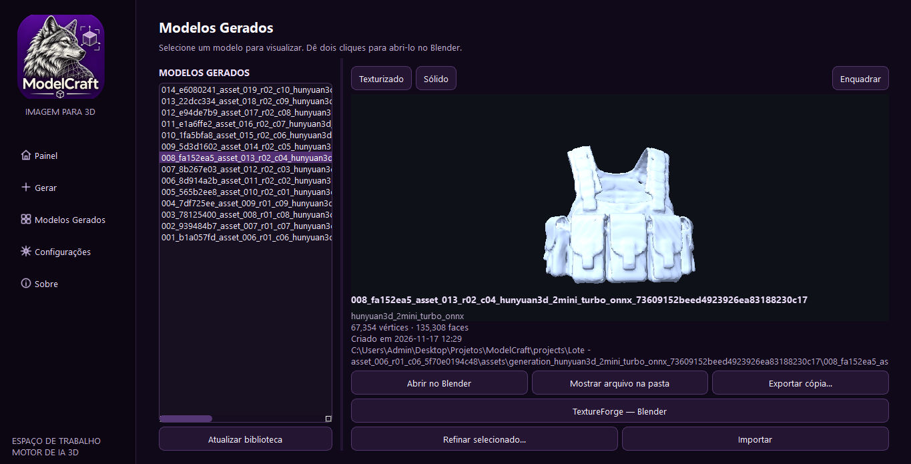

  
  <h1>ModelCraft</h1>
  
<strong>Transforme imagens em assets 3D — localmente, com controle sobre o seu fluxo.</strong>

  

    <a href="https://github.com/IGOR-SciDATA/modelcraft/issues">Reportar problema</a>
  

  

    
    
    
  

---

## Visão geral

**ModelCraft** é um aplicativo desktop para transformar fotografias em modelos e assets 3D. O projeto reúne motores de reconstrução, processamento de imagem, ferramentas de geometria e visualização em um único fluxo de trabalho para Windows.

A proposta é permitir que o usuário trabalhe com processamento local, sem depender de créditos por geração ou de uma GPU dedicada para os fluxos compatíveis com CPU.

  
  Interface do ModelCraft 0.1.0

## O que oferece

- **Geração a partir de imagem:** fluxo de entrada de uma fotografia e geração de asset 3D.
- **Processamento local em CPU:** motores ONNX para execução local, sem exigir CUDA.
- **Pré-processamento:** remoção de fundo e preparação da imagem.
- **Mais de uma estratégia:** geração procedural 2.5D e reconstrução volumétrica por IA, cada uma com suas características.
- **Fluxo multivista:** possibilidade de fornecer fotografias adicionais (frente, laterais, topo e traseira) para apoiar a reconstrução.
- **Visualizador 3D:** inspeção dos resultados e exportação em formatos como GLB, GLTF e OBJ.
- **Refinamento:** ferramentas para limpeza, remeshing e ajustes de malha, com preservação do arquivo original.

## Como funciona

O ModelCraft hoje ainda está em versão de testes:

| Modo | Abordagem |
|---|---|
| TESTE | Apenas alguns usuários selecionados, a fim de melhorarmos antes do release oficial |
| SOLICITAR | Caso tenha interesse em participar do beta fechado, só entrar em contato através do perfil. |

## Download e instalação

A distribuição do ModelCraft 0.1.0 será disponibilizada pelo **Google Drive**, em uma pasta única contendo o instalador do aplicativo e os arquivos necessários dos motores de IA.

**Link para download:** será publicado aqui assim que o envio e o compartilhamento da pasta forem concluídos.

O pacote de modelos ocupa aproximadamente **11,44 GB**. Reserve espaço adicional para a instalação. O Blender não está incluído e deverá ser instalado separadamente para os recursos que dependem dele.

## Licenças e modelos

O software integra componentes e modelos de terceiros, cada um com suas próprias condições de licença. Consulte os avisos e arquivos de licença incluídos na distribuição e nos projetos de origem antes de redistribuir ou utilizar componentes individualmente.

## Aviso sobre resultados

A qualidade de um modelo depende da fotografia, do objeto, do motor selecionado e dos dados observados. Uma malha fechada (*watertight*) não significa necessariamente que a geometria seja fiel. Textura de alta resolução também não aumenta, por si só, a resolução da malha.

---

  <strong>ModelCraft 0.1.0</strong> 
  Imagem → Geometria → Asset 3D

